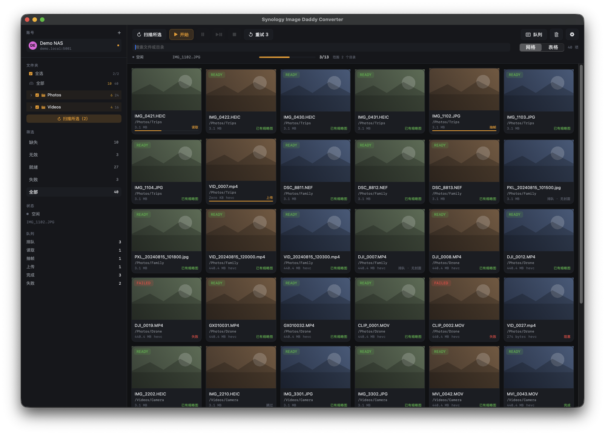
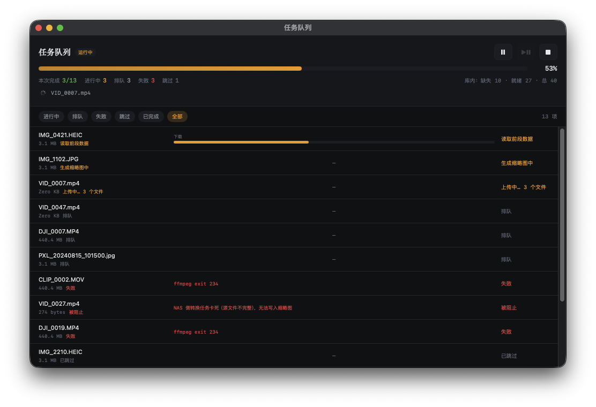
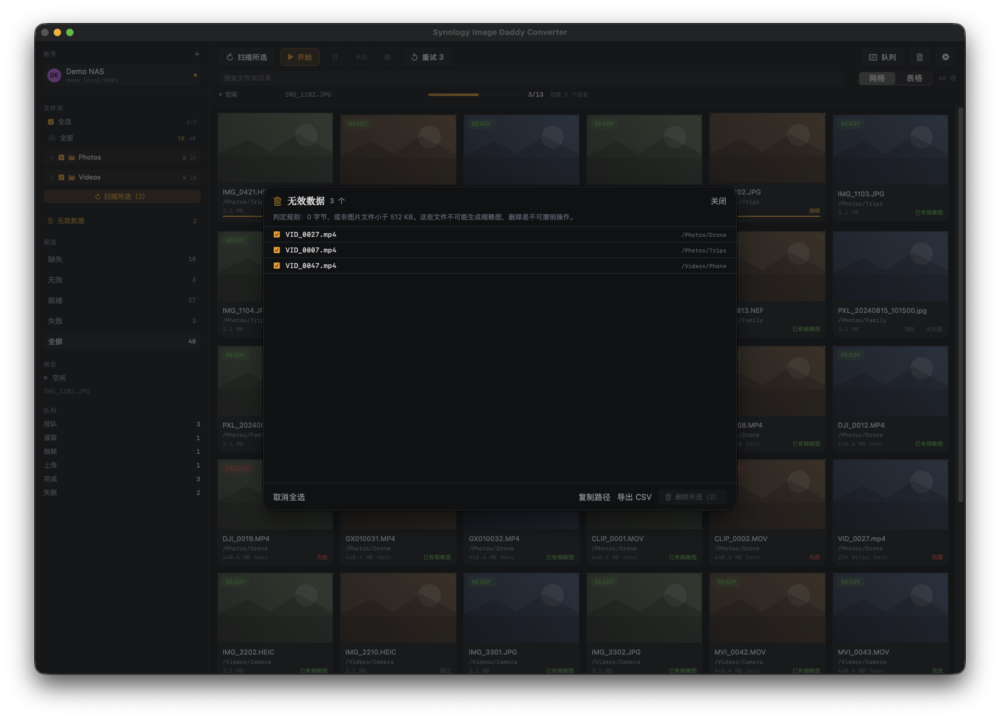

# Synology Image Daddy Converter

给 Synology Photos 批量补缩略图的 macOS 原生应用。

不转码、不生成副本、不动原文件——只读取每个视频的几 MB，解出一帧，把三张 JPEG 写回 NAS。



---

## 背景：为什么照片墙会没有封面

这不是"NAS 不会解码"，而是群晖主动改了架构。

**从 DSM 7.2.2 开始，H.265（HEVC）、H.264（AVC）、VC-1 的编解码负载从服务器端转移到了终端设备**，官方理由是减少 NAS 不必要的资源占用——这些编码在手机、平板、电脑上早已普及（[IT之家报道](https://www.ithome.com/0/791/735.htm)）。

代价是：NAS 不再自己处理这些视频的预览。于是当缩略图没能在索引阶段生成时，Photos 只能一直显示空白，等你点开它在终端上解码。

群晖给出的官方方案是 **Synology Image Assistant**：一个桌面程序 + 浏览器扩展，在电脑上生成预览和压缩视频，再回传 NAS（[技术规格](https://www.synology.com/en-global/dsm/7.4/software_spec/image_assistant)）。它要求：

- NAS 运行 DSM 7.2.2 或以上
- 浏览器安装扩展
- 电脑具备 HEVC 解码器（macOS 12.3 及更早不支持）

这个方案能解决"没有预览"，但用起来有明确的边界——本项目针对的正是这些边界。

## 与 Synology Image Assistant 的对比

| 维度 | Synology Image Assistant | 本项目 |
|---|---|---|
| **形态** | 浏览器扩展 + 桌面程序 | 单一原生 macOS 应用（含菜单栏常驻） |
| **触发方式** | 在 Photos 网页里逐项/批量触发，需保持浏览器与扩展在线 | 桌面端勾选目录 → 扫描 → 批量处理，可无人值守 |
| **产物** | 预览 **+ 压缩视频副本**（完整重编码） | **仅三档 JPEG**，约 730 KB/项 |
| **处理量** | 一个 16 GB 视频要完整解码 + 编码一遍 | 同一视频只读 5–13 MB，解 1 帧 |
| **耗时量级** | 分钟到小时级（取决于视频长度） | 秒级（实测 2–7 秒/个） |
| **磁盘占用** | 生成副本，占用成倍增长 | 不生成副本 |
| **编码器依赖** | 依赖系统 HEVC 解码器 | AVFoundation + 内置 ffmpeg，PS/TS 容器同样能解 |
| **非标准封装** | 按扩展名识别，MPEG-PS 伪装成 `.mp4` 的文件常失败 | **容器嗅探**：读头部判断真实封装，走对应解码路径 |
| **索引在文件末尾的 MP4** | 依赖系统解码器的读取策略 | 主动读尾部 `moov` + 定位首帧样本，稀疏重组后解码 |
| **失败可见性** | 显示"转换中/失败"，原因有限 | 队列逐条给出**具体原因**，并区分失败/阻塞/跳过 |
| **重试** | 需手动重新触发 | 队列一键重试；对服务器临时拒绝做退避重试 |
| **状态一致性** | 依赖网页刷新 | 本地"已完成清单" + 处理前向 NAS 逐个校验 |
| **只想要封面时** | 仍要付出完整转码成本 | 只做封面，成本低一个数量级 |

**一句话**：官方工具解决的是"让视频能在各种设备上播放"，本项目解决的是"让照片墙有封面"。如果你的目标是后者，前者的代价（完整转码 + 副本存储）是不必要的。

## 功能

### 目录级批量处理

勾选任意层级的目录，网格只显示勾选范围内的内容；扫描分两步（发现目录 → 读取文件），进度可见。


### 独立任务队列

每个文件分「下载 / 抽帧 / 上传」三段显示进度；失败直接给出原因，支持按阶段筛选、分页、重试。



### 无效数据单独归类

0 字节，或非图片且小于 512 KB 的文件不可能生成缩略图——单独归类，永不进入队列，可导出 CSV 或复制路径。



## 处理策略

目标始终是"只读能解出一帧的最小数据量"：

| 文件类型 | 读取范围 | 典型耗时 |
|---|---|---|
| 普通 MP4 / MOV（`moov` 在头部） | 索引 + 首帧样本，约 10–13 MB | 1–3 秒 |
| MP4（`moov` 在尾部） | 尾部 2 MB 定位 `moov` + 首帧样本 | 2–6 秒 |
| MPEG-PS / TS（扩展名写成 `.mp4` 的监控录像） | **256 KB 前缀**，失败才升到 2 / 8 / 24 MB | 2–7 秒 |
| 照片（含 RAW：CR2 / CR3 / NEF / DNG …） | 原图，交给 ImageIO | 0.1–2 秒 |
| 空文件 / 截断文件 | 不处理，归入「无效数据」或「阻塞」 | — |

16 GB 的视频与 200 MB 的视频，读取量都在几 MB 量级。

## 技术实现

### 1. 接口层

所有请求走 Photos 的 `SYNO.FotoTeam.*` 命名空间（DSM 7.x），通过 `webman/entry.cgi`：

| 用途 | 接口 | 关键点 |
|---|---|---|
| 登录 | `SYNO.API.Auth` v6 | `session=webui`，返回 Cookie + `X-SYNO-TOKEN` |
| 目录 | `SYNO.FotoTeam.Browse.Folder` v2 | `name` 是相对根的路径，不是叶子名 |
| 条目 | `SYNO.FotoTeam.Browse.Item` v7 | `additional=["thumbnail","video_meta","resolution"]` |
| 三档状态 | 同上，`additional.thumbnail` | `sm/m/xl` ∈ `ready` / `converting` / `ame_defect` / `broken` |
| 下载 | `SYNO.FotoTeam.Download` v1 | 必须用 `item_id`（不是 `unit_id`），支持 Range |
| 建任务 | `SYNO.FotoTeam.RegeneratePreview` v1 `set_regenerating` | 返回 `unit_id`，上传时必须用它 |
| 上传 | `SYNO.FotoTeam.Upload.ConvertedFile` v3 | multipart，字段 `thumb_xl` / `thumb_m` / `thumb_sm` |

版本号不是猜的：`ConvertedFile` 在网页客户端里明确固定为 `3`（虽然 `API.Info` 宣称支持到 5），照抄客户端行为才稳定。

### 2. 三条解码路径

**A. AVFoundation 在线抽帧**

用 `AVAssetResourceLoaderDelegate` 注册自定义 scheme（`sia://item/<id>`），把 AVFoundation 发出的读取请求实时翻译成 NAS 的 Range 请求。这样它只会拉取 `moov` 与首帧样本，而不是整段视频。

**B. 尾部索引 + 稀疏重组**

`moov` 在文件末尾的 MP4，AVFoundation 在慢链路上容易超时。此时：

1. 读尾部 2 MB，倒序找 `moov`；找不到则按 box size 逐个跳过（每次只读 16 字节）定位
2. 解析 `stco`/`co64` 与 `stsz`，拿到首个视频样本的绝对偏移与长度
3. 构造**稀疏文件**：写入头部（含 `ftyp`）、把该样本写到它的真实偏移、把 `moov` 写到它的真实偏移，其余留空
4. `ffmpeg` 从偏移 0 解一帧（不 seek，否则会跳进空洞）

实测一个 470 MB 的 XAVC 素材：读取约 5 MB，6.2 秒出图。

**C. 前缀解码**

MPEG Program Stream / Transport Stream 是顺序流，第一帧就在开头。但群晖和 AVFoundation 都按扩展名判断，`.mp4` 里装着 PS 流时直接报 "Cannot Open"。

处理方式：先读 64 KB 嗅探 `ftyp`；不是 MP4 就跳过 AVFoundation（省掉它 60 秒的超时等待），直接取 256 KB 前缀交给 ffmpeg，解不出再逐级放大。

**图片**走 ImageIO（支持 RAW 与 EXIF 方向），ffmpeg 失败时也会回退到 ImageIO。

### 3. 状态模型

每个条目只有两个事实来源：**NAS 的扫描快照** 与 **本工具的成功写入记录（done 清单）**。

```
就绪 = NAS 三档齐全  ∪  done 清单包含该 id
```

- 处理每个文件前，向 NAS 发一个小请求确认；已就绪则直接标记完成，跳过解码
- 扫描结束后用新结果校准 done 清单：NAS 说没有的，重新排队
- 所有界面（侧边栏、筛选、网格徽标、检查器、队列）共用同一个判定函数与同一份聚合缓存

### 4. 失败分类

| 分类 | 触发 | 行为 |
|---|---|---|
| 跳过 | 0 字节 / 非图片 < 512 KB / 无 `moov` 的残缺录像 | 不再重试 |
| 阻塞 | 上传返回 117，且单位停在 `converting` | 不自动重试（通常是源文件残缺） |
| 失败 | 解码或上传的其他错误 | 显示原因，可重试 |

对 NAS 的临时拒绝（重建索引、繁忙时返回的 117）做 4 次退避重试（2/4/6 秒）；确认是持久性权限问题则中止整轮，避免刷出成百上千条假失败。

### 5. 并发与资源

- 6 路 worker，视频抽帧单独限流，缩略图请求 5 路
- 缩略图内存缓存上限 400 张，磁盘清单原子写入并保留 `.bak`
- 源文件只读，绝不修改、移动或删除

## 安装

### 依赖

```bash
brew install ffmpeg
```

macOS 13+，Swift 6.x（Command Line Tools 即可）。

### 构建

```bash
git clone https://github.com/dream7zz/Synology-image-daddy-converter.git
cd Synology-image-daddy-converter
swift build -c release
./scripts/make-app.sh
open "dist/Synology Image Daddy Converter.app"
```

### 命令行诊断工具

```bash
export SIA_HOST=your-nas.local:5001
export SIA_ACCOUNT=your-account

.build/release/siactl folders                 # 列出根目录
.build/release/siactl thumbcheck --id 12345   # 查看三档状态
.build/release/siactl avframe --id 12345      # AVFoundation 抽帧自检
.build/release/siactl tailtest --id 12345     # 尾部索引方案自检
.build/release/siactl prefixtest --id 12345   # 前缀解码方案自检
```

工具内没有任何硬编码的服务器地址，缺少参数会直接报错退出。

## 使用

1. **添加账号**：NAS 地址（`host:5001`）、账号、密码；密码仅存 macOS Keychain
2. **勾选目录**：左侧目录树按需勾选，网格只显示勾选范围
3. **扫描所选**：两步进行（发现目录 → 读取文件）
4. **开始**：只处理「缺失」条目；「开始」不会重新扫描
5. **看队列**：独立窗口显示每个文件的下载 / 抽帧 / 上传进度与失败原因

## 演示模式

不连接任何 NAS，用本地生成的假数据渲染界面（本文截图即由此产生）：

```bash
SIA_DEMO=1 open -a "Synology Image Daddy Converter"
SIA_DEMO=1 SIA_DEMO_QUEUE=1 SIA_OPEN_QUEUE=1 open -a "Synology Image Daddy Converter"
```

## 已知限制

- **不生成可播放副本**。本项目只做封面；如果你需要"任何设备都能播放"的兼容视频，请使用官方的 Synology Image Assistant。
- **NAS 侧卡死无法绕过**。当 NAS 把条目永久标记为 `converting`（多见于源文件残缺），上传接口一律拒绝（117）。这属于服务端状态，需要管理员重建索引，或补传完整文件。
- **重建索引需要管理员**。普通账号调用 `Index.reindex` 会返回 105。
- **删除功能未实现**。界面按钮默认禁用。
- **仅面向 DSM 7.x**。接口基于 Photos Web 客户端逆向所得，DSM 版本差异可能导致行为变化。

## 隐私

- 密码保存在 macOS Keychain，代码与配置中不含明文
- 无遥测、无第三方请求；所有流量只发往你填写的 NAS
- 不修改原文件，仅写入三张缩略图

## 目录结构

```
Sources/
  SIACore/                 核心逻辑（不依赖 UI）
    Scanner.swift            目录树与条目扫描
    Engine.swift             任务编排：下载 → 抽帧 → 上传
    NASClient.swift          登录、Cookie、Token、Range 请求
    Fetcher.swift            分块读取与容器嗅探
    VideoFrame.swift         AVFoundation 在线抽帧
    MP4TailIndex.swift       尾部索引定位与稀疏重组
    Thumbnailer.swift        ffmpeg 抽帧与三档缩放
    ImageThumbnailer.swift   ImageIO（含 RAW）
    WriteGate.swift          上传白名单与确认流程
    SettingsStore.swift      配置持久化
  SIAApp/                  SwiftUI 界面
    DemoMode.swift           截图用的本地假数据
  siactl/                  命令行诊断工具
  siatest/                 自检程序
scripts/make-app.sh        打包 .app
assets/                    应用图标
```

## 参考

- [Synology Image Assistant 技术规格](https://www.synology.com/en-global/dsm/7.4/software_spec/image_assistant)
- [DSM 7.2.2 编解码负载转移至终端（IT之家）](https://www.ithome.com/0/791/735.htm)

## 免责声明

本项目通过逆向 Synology Photos 的 Web 接口实现，与 Synology 官方无关。
使用前请自行确认账号权限并做好数据备份；对因使用本工具造成的任何数据问题不承担责任。
